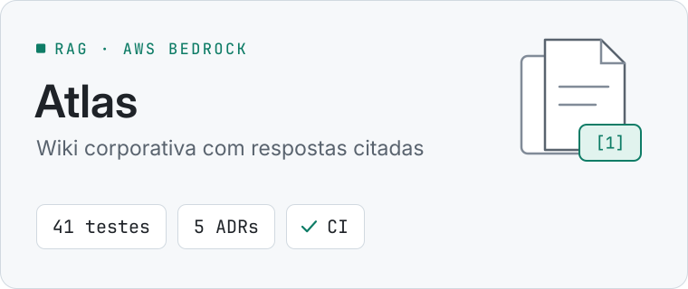
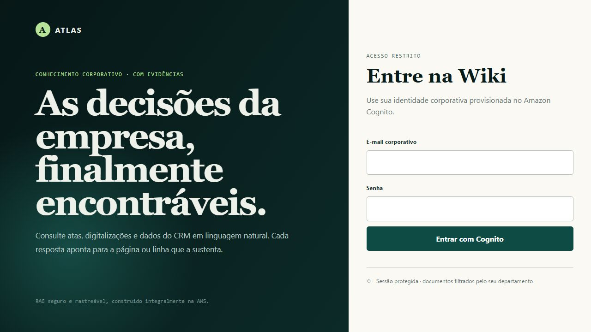
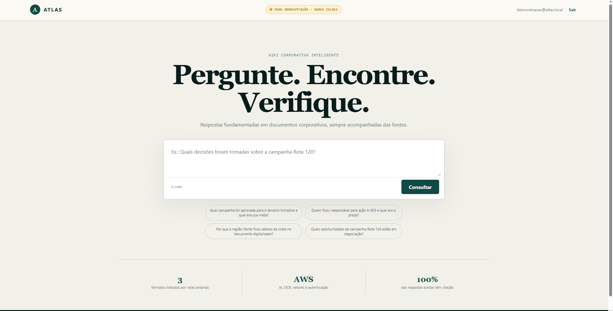
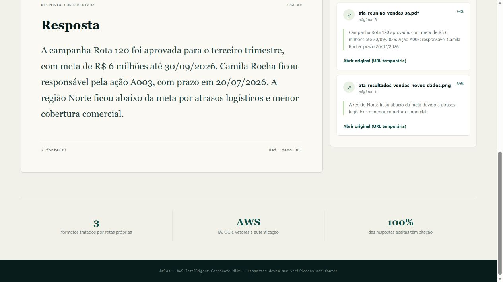
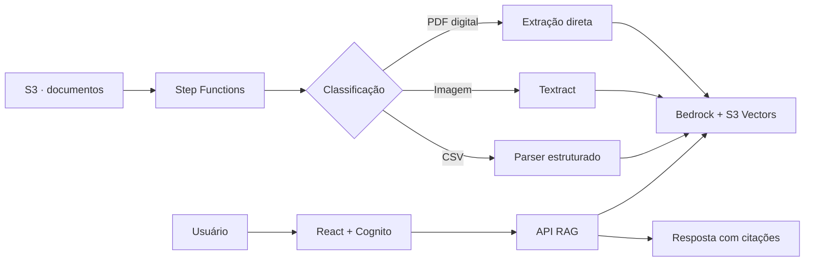

<picture>
  <source media="(prefers-color-scheme: dark)" srcset="docs/assets/cover-dark.svg">
  
</picture>

<p align="center"><strong>Documentos dispersos transformados em conhecimento pesquisável, seguro e rastreável.</strong></p>

<p align="center">
  <a href="https://github.com/YanCarneosso/aws-intelligent-corporate-wiki/actions/workflows/ci.yml"></a>
  <a href="pyproject.toml"></a>
  <a href="apps/web"></a>
  <a href="docs/architecture.md"></a>
</p>

## Em 30 segundos

- **Problema:** conhecimento corporativo espalhado em PDFs, documentos escaneados e planilhas de CRM, difícil de consultar e sem garantia de origem.
- **Solução:** plataforma RAG na AWS com ingestão específica por formato (extração direta, Amazon Textract ou parser estruturado), Amazon Bedrock Knowledge Bases, Guardrails e autorização por departamento e nível de confidencialidade.
- **Resultado:** respostas que citam a fonte exata (página do PDF ou linha do CSV) e abstenção quando não há evidência. 41 testes aprovados, CI, 5 ADRs, modelo de ameaças, modelo de custos e metodologia de avaliação do RAG.
- **Stack:** Python 3.12 · TypeScript · React · Amazon Bedrock · Textract · Step Functions · Lambda · Cognito · AWS CDK
- **Por onde começar:** [arquitetura](docs/architecture.md) · [avaliação do RAG](docs/rag-evaluation.md) · [modo demonstração da interface](#executar-a-interface)

## Sobre o projeto

O **Atlas** é uma plataforma RAG que ingere PDFs digitais, documentos escaneados e
dados de CRM. Cada formato recebe um processamento próprio antes de ser indexado e
consultado com Amazon Bedrock.

As respostas são baseadas apenas nas evidências recuperadas e apresentam a fonte
original — página do PDF ou linha e oportunidade do CSV. Quando não há suporte
suficiente, o sistema se abstém em vez de inventar uma resposta.

## Interface

| Acesso seguro | Consulta autenticada |
|---|---|
|  |  |



## Como funciona



### Principais recursos

- processamento específico para PDF, imagem e CSV;
- Amazon Bedrock, Knowledge Bases, Guardrails e S3 Vectors;
- autenticação Cognito e autorização por departamento/confidencialidade;
- proveniência, citações, abstenção, idempotência e observabilidade;
- infraestrutura reproduzível com AWS CDK.

## Executar a interface

```bash
pnpm install --frozen-lockfile
pnpm dev
```

Acesse `http://127.0.0.1:5173`. Para conhecer todas as telas sem provisionar a AWS,
use `http://127.0.0.1:5173/?demo=1`; os dados exibidos nesse modo são locais e ilustrativos.
Autenticação e consultas reais dependem do ambiente AWS provisionado.

## Documentação completa

| Tema | Documento |
|---|---|
| Arquitetura e decisões | [Arquitetura](docs/architecture.md) · [Registros de decisão](docs/decisions) |
| Pipeline ponta a ponta | [Fluxo de dados](docs/data-flow.md) |
| Segurança e ameaças | [Segurança](docs/security.md) · [Modelo de ameaças](docs/threat-model.md) |
| Custos e observabilidade | [Custos](docs/cost-model.md) · [Observabilidade](docs/observability.md) |
| Avaliação do RAG | [Metodologia e dataset](docs/rag-evaluation.md) |
| Instalação e apresentação | [Implantação](docs/deployment.md) · [Roteiro de demonstração](docs/demo.md) |
| Resposta oficial do desafio | [resposta.md](resposta.md) |

> Comece pela [documentação de arquitetura](docs/architecture.md) para conhecer os
> componentes, decisões técnicas, limitações e caminhos de evolução.

## Estado

Código, testes, frontend e CDK synth estão validados localmente. O deploy AWS não foi
executado neste ambiente; as evidências reais estão em [`docs/evidence`](docs/evidence).

## Origem


Este projeto amplia o desafio
[A Wiki Perdida dos Arquivos Corporativos](https://github.com/digitalinnovationone/laboratorio-wiki-aws),
da Digital Innovation One, com uma implementação de referência orientada a produção.

Desenvolvido como projeto de portfólio de **Inteligência Artificial & Cloud**.
