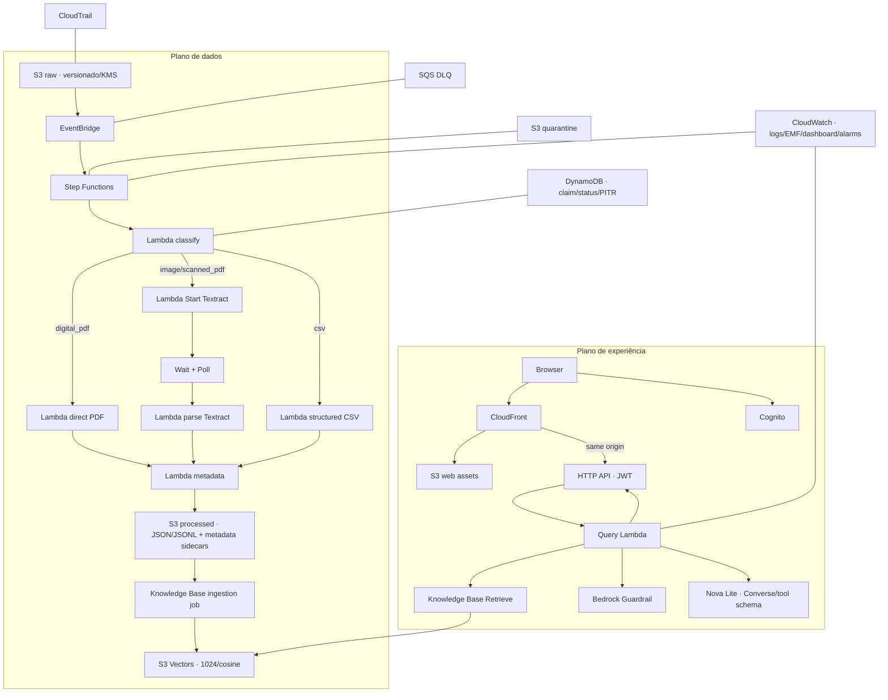

# Arquitetura

## Objetivos e limites

A solução converte um acervo misto em uma interface autenticada de perguntas e
respostas. O limite de confiança é explícito: uma resposta só é aceita se houver ao
menos uma evidência recuperada, autorizada, acima do limiar e citada. O original é
imutável do ponto de vista do pipeline; qualquer derivado vive no bucket processado.

## Componentes

| Camada | Implementação | Responsabilidade |
|---|---|---|
| Entrada | S3 + EventBridge | durabilidade, versão e evento de criação |
| Orquestração | Standard Step Functions | branches, polling, retries, catch e estado visível |
| Processamento | Lambdas Python 3.12 ARM64 | classificação, parsing, normalização, metadados e sync |
| Estado | DynamoDB | claim atômico por ID determinístico e lifecycle do documento |
| Conhecimento | Bedrock KB + Titan Embeddings v2 + S3 Vectors | ingestão, filtro e recuperação vetorial |
| Geração | Nova Lite + Guardrails | resposta estruturada, concisa e controlada |
| API | HTTP API + JWT authorizer | entrada autenticada e contrato validado |
| Web | React + S3 + CloudFront/OAC | experiência, runtime config e proxy same-origin |
| Auditoria | CloudWatch + CloudTrail | investigação técnica e ações de controle |

## Modelo canônico

`shared/schemas/models.py` é o contrato executável. `CanonicalDocument` contém
`SourceObject` com versão/ETag/hash, classificação, método de processamento,
`DocumentMetadata`, chunks e qualidade. Cada `Chunk` carrega localizador próprio.
As saídas do Bedrock são validadas com `extra="forbid"` para detectar drift.

Os arquivos para a Knowledge Base são JSONL pré-divididos e acompanhados de
`.metadata.json`. Metadados de filtro são deliberadamente pequenos e escalares:
`document_id`, `chunk_id`, `source_file`, `department`, `confidentiality`, página ou
linha/ID. O documento canônico completo permanece no S3, não no índice.

## Disponibilidade e escala

- S3, DynamoDB on-demand, Lambda, API Gateway e S3 Vectors escalam sem hosts.
- Textract é assíncrono e a Step Function espera fora de Lambda; arquivos grandes
  não mantêm computação ociosa.
- A ingestão de Knowledge Bases é serializada quando o serviço informa job ativo.
- Limites de concorrência e quotas de Bedrock/Textract devem ser definidos por
  ambiente após medição. Retentativas tratam throttling, não substituem quota.
- O desenho é single-region. Multi-region, DR e replicação são evolução de produção.

## Consistência e falhas

A consulta enxerga conteúdo após o job de ingestão ficar `COMPLETE`; isto é
consistência eventual intencional. Antes disso, o estado continua observável no
DynamoDB/Step Functions. Erro irrecuperável atualiza o registro e envia o objeto
um registro redigido na quarentena sem apagar o original. O reprocessamento exige nova versão ou ação
operacional explícita, evitando duplicação silenciosa.

## Decisões não tomadas

Não há ECS/EKS, broker dedicado, banco relacional ou agent loop: eles não resolvem
uma necessidade presente. Knowledge Bases absorve embeddings e indexação; Lambda é
adequada aos processadores curtos e Step Functions cobre o trabalho assíncrono.
